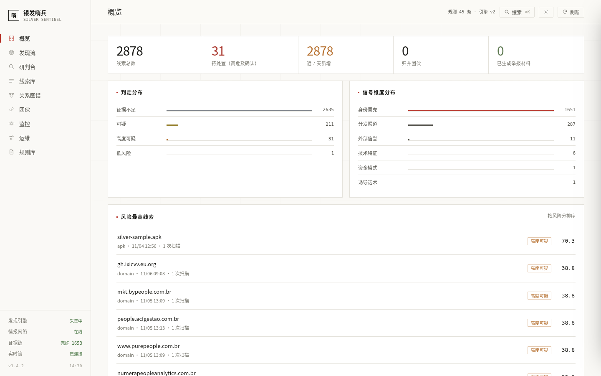
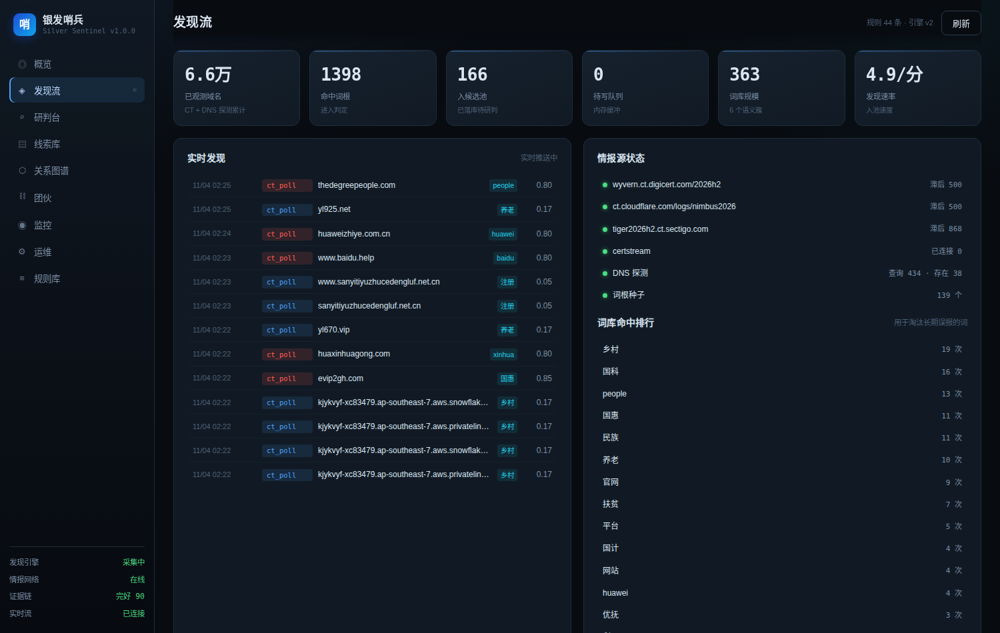
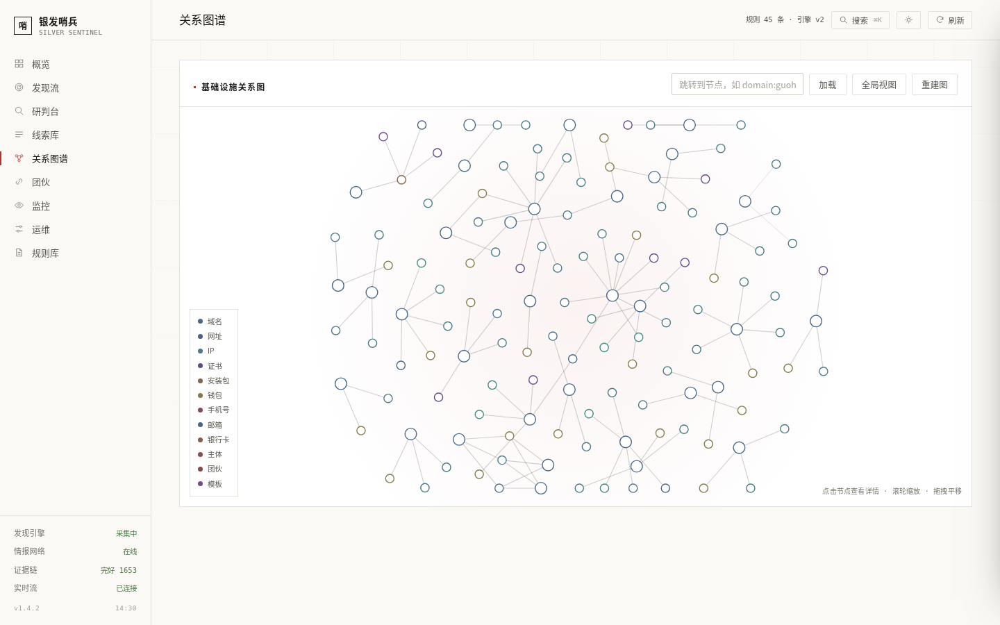

# 银发哨兵 · Silver Sentinel

面向「领鸡蛋骗局」线上化形态的 **持续发现 — 动态取证 — 图谱归因 — 处置闭环** 系统。

不是又一个钓鱼网址库，而是针对中国涉老诈骗特有载体的一套研判工程：**应用商店搜不到、没有 ICP 备案、只能扫码安装的仿冒「国家项目」App**，以及围绕它运转的微信群裂变、签到返利、拉人头与虚拟货币收款。

v1.0 的定位从「拿线索来查」改成「**挂在服务器上一直盯着**」：CT 日志、域名排列、备案库三路并行发现，证据只追加不修改，团伙按图上的共同基础设施归并，沙箱里真跑页面与安装包。

v1.1 补齐了长期运行最要命的两块：**证据仓**（原始文件加密、账本与保管链可验证、多端可合并）与**出站防护**（无代理不碰可疑目标、导出物零自身标识）。

v1.2 修的是「发现了但不可信」：词库从子串匹配改成音节对齐（存量噪音 78% 被识别），
凭证指纹入图，接入工信部备案与违法违规名单，动态取证补上 HTML／截图／网络请求三份原始证据。
22 小时实测复盘见 [docs/11](docs/11-结果复盘与优化.md)。

v1.5 修的是「能力都在，但没有接线」：取证从「只有手工调用」变成排队自动跑（优先级 + 退避 + 三入口），
证据从「文件躺在磁盘上」变成界面里的八格矩阵（预览／下载／软删除／整套 ZIP），
概览从「五个失真数字」变成一项可解释的风险指数（四项加权 + 原始计数 + 七日趋势），
分级产出自动进监控并做六种指纹的变更检测，DeepSeek 密钥与取证出口都能在前端改、保存即生效。
落地细节与实测数据见 [docs/16](docs/16-取证闭环与运行时配置.md)。



---

## 为什么需要它

线下那套「免费领鸡蛋 → 健康讲座 → 专家义诊 → 高价特效药」并没有消失，只是把最后一步搬到了手机上。央视 2026 年 10 月公布的典型案例里，一个团伙用「免费领鸡蛋」「专家义诊」引流，发展成「老板操控、讲师授课、门店收割」的产业链，抓获 120 人、涉案 500 余万元。同期公安部通报的涉诈 App 案件，涉案金额已达 60 亿元量级。

这类骗局有几个传统 URL 黑名单拦不住的特征：

| 特征 | 为什么难拦 |
| --- | --- |
| 载体是 APK，不是网页 | 网页能下线，安装包留在老人手机里继续跑 |
| 应用商店搜不到，只能扫码/外链装 | 绕过了商店审核这一道最有效的关口 |
| 域名寿命以周计 | 黑名单永远慢一步，得靠证书/模板/收款地址做归并 |
| 话术高度本地化 | 「民族资产解冻」「国补」「高龄补助」这类词，通用引擎识别不了 |
| 受害人不报案 | 老人常因「家丑不可外扬」错过追赃时机，线索需要主动发现 |

银发哨兵针对的正是这五点。

---

## v1.0 做了什么

| 环节 | v0.1 | v1.0 |
| --- | --- | --- |
| **发现** | 关键词盯 crt.sh，单点 | CT 日志直连（RFC 6962）+ certstream + 域名排列探测，三路冗余；词库 363 词根 / 6 语义簇，中文词自动派生拼音变体，实测 5 万域名/秒匹配 |
| **准入** | 高分才入库 | 命中一个词就入库（`candidate` 档），先记录再评估，确认无害才降级/冷存 |
| **取证** | 只存数据库 | 只追加事件日志（哈希链 + fsync）+ 增量分片副本（dir/S3/WebDAV）+ 内容寻址证据文件 |
| **归因** | 字段比对猜团伙 | 图数据库（内置 SQLite 图引擎 / Neo4j）20 类节点、17 种关系，社区发现自动成团，共用证书权重远高于共用 IP |
| **动态** | 不碰可疑站点 | 沙箱内真跑网页（Playwright，阻断内网与非 GET）、APK（MobSF / adb / 静态推演三级降级） |
| **运营** | 无 | 能力降级自陈、任务记账、Prometheus 指标、SSE 实时流、运维页 |



---

## 能力

| 环节 | 具体做什么 |
| --- | --- |
| **发现** | 监听 CT 日志新证书、按语义簇派生域名排列做 DNS 探测、按词根翻历史证书；命中即入库，同时记录「为什么进来」 |
| **研判** | 58 条可解释规则（含 14 条页面内容规则）+ 词库暗示 + 灰度 LLM；输出风险分、判定等级、逐条可核对的依据，LLM 结论必须用 `[E:编号]` 引用证据 |
| **记录** | 线索库 + 证据哈希链；八类证据矩阵（HTML／正文／首屏／全页／网络／证书／表单／安装包），每条可预览、可单条下载、可软删除（进回收站、链不断） |
| **取证** | 取证队列自动跑：已确认/观察中优先、分数高的先跑、失败按 10/40 分钟退避；变更检测比对正文 simhash、截图 dHash、证书、解析、包哈希、HTTP 状态 |
| **监控** | 分级（candidate/watch/confirmed/cold/dismissed）+ 驻留衰减；高危自动纳管复访，变更次数与上次/下次时间都在界面里 |
| **归因** | 域名、证书指纹、模板指纹、钱包地址、收款手机号、备案主体、包名、内嵌域名进同一张图，社区发现成团，输出「谁和谁是一伙的、凭什么」 |
| **处置** | 一键生成证据包（PDF + ZIP + 逐文件哈希）与填表载荷；浏览器扩展把字段直接填进 12377 / 12321 / 腾讯网址安全中心的受理表单，人只需过验证码与提交。举报对象指向**主体与基础设施**，不是单个安装包 |



---

## 快速开始

```bash
git clone https://github.com/stellarissss/silver-sentinel.git
cd silver-sentinel
python3 -m pip install -e ".[full]"     # 不加 [full] 也能跑，只是少了沙箱/流式/S3/Neo4j

silver-sentinel serve                   # 控制台 http://127.0.0.1:18700
```

零配置即可运行：不配任何 key 时，系统只用本地规则引擎 + 内置图引擎，LLM 与沙箱环节自动弃权，并在运维页明示——不会假装可用。

### 长期监控怎么起

```bash
# 一个进程全包：发现引擎 + 周期调度 + 副本 + 控制台
SILVER_AUTOSTART=1 silver-sentinel serve --host 0.0.0.0 --port 18700

# 或者分开跑，各自独立重启
silver-sentinel discover run          # 发现常驻
silver-sentinel serve                 # 控制台
```

`SILVER_AUTOSTART_MONITOR=1` 是旧写法，两种都认。

监听非回环地址时**必须**设 `SILVER_WEB_PASSWORD`，否则进程直接拒绝启动——研判台上是正在跟踪的目标清单，不该裸奔在公网上。

### 部署到服务器

```bash
bash deploy/push.sh root@<服务器IP>     # 本机执行：传包 + 远端安装 + 自检
```

服务器侧由 `deploy/install.sh` 全包：系统账号、venv、systemd（程序目录只读、数据目录独立）、随机口令、健康检查、防火墙放行。幂等，可反复执行；重复升级不会重置口令。详见 [控制台与访问控制](docs/14-控制台与访问控制.md)。

### Docker

```bash
cp .env.example .env
docker compose up -d --build                    # 最小可用
docker compose --profile graph up -d            # + Neo4j
docker compose --profile replica up -d          # + MinIO（异地副本）
docker compose --profile sandbox up -d          # + MobSF（APK 动态分析）
```

默认只绑 `127.0.0.1:18700`。对外提供服务请用 `deploy/` 下的一键脚本（自带口令与 systemd 加固），或在反代上加 TLS。

---

## 命令行

```bash
# 研判单条线索（现场排查）
silver-sentinel scan url "http://kuaishou-yinfa.top/reg?invite=888" \
  --text "免费领鸡蛋，应用商店搜不到，请点击继续安装"
silver-sentinel apk ./samples/guohui.apk

# 发现层
silver-sentinel discover words                    # 看词库覆盖（363 词根 / 6 簇）
silver-sentinel discover inject guohui-vip.top    # 人工导入线索清单
silver-sentinel discover inject --file seeds.txt  # 批量导入
silver-sentinel discover search 国惠 中科 民族资产 # 翻 crt.sh 历史补漏
silver-sentinel discover status                   # 吞吐、游标、DNS 池健康

# 流水线
silver-sentinel cycle                             # 研判→富化→建图→团伙→衰减
silver-sentinel enrich 42 --probe                 # 单个目标富化并实测网页
silver-sentinel graph rebuild                     # 重建图谱并重新归并团伙
silver-sentinel rescore --limit 2000              # 用已取到的正文重算评分（升级后必跑）
silver-sentinel rescore --retier --limit 6000     # 规则口径变更后连分级一起重算
silver-sentinel dismiss 1 --reason "演示样例包"    # 人工排除，之后重评不会拉回来
silver-sentinel health                            # 进程内能力 + 取证队列健康度
silver-sentinel doctor                            # 存活自检（看门狗用，异常退出码 1）
silver-sentinel brief --hours 24                  # 侦查态势：发现/取证/证据增量，断了就返回 1

# 身份核验（白名单 + 冒充判定）
silver-sentinel whitelist                          # 白名单规模与加载状态
silver-sentinel whitelist --check www.mof.gov.cn np4w53.cn
silver-sentinel claim https://example.com          # 抽「自称」，判是否冒充政府机构
silver-sentinel icp --license 京ICP备202600001号-1  # 备案号反查（抓伪造备案）

# 用途分类（词库保广、模型保细）
silver-sentinel purpose https://www.53kf.com        # 这站是干什么的：客服/论坛/电商/企业/落地页
silver-sentinel purpose --asset-id 42               # 用库内已存证据分析，不联网
silver-sentinel model status                        # 模型是否加载、算法与指标
silver-sentinel model train                         # 用内置种子集重训

# 证据可靠性
silver-sentinel log verify                        # 逐条重算哈希链
silver-sentinel log tail -n 30                    # 看最近发生了什么
silver-sentinel trash --list                      # 回收站里有什么（软删除的记录永久保留）
silver-sentinel trash --purge-days 30             # 只清 30 天前的文件，删除记录不动
silver-sentinel replica sync --with-db            # 推一次异地副本
silver-sentinel replica restore                   # 从副本拉回事件日志

# 运营
silver-sentinel ops                               # 能力降级 + 积压 + 完整性一屏
silver-sentinel list --verdict high_risk
silver-sentinel report 3 --channel 12321 --out 举报材料.md
```

---

## 发现层：宁可错杀一万

发现的难点不是「找不到坏域名」，而是**在几十亿条证书里既不漏、又不把自己跑死**。

### 四路冗余

| 通路 | 做什么 | 断了会怎样 |
| --- | --- | --- |
| **CT 日志直连**（主路） | 按 RFC 6962 轮询 `get-sth` / `get-entries`，解析 DER 取 CN 与 SAN；游标落盘，重启续跑 | 换下一个日志。内置日志集按国内可达性排序 |
| **certstream**（补强） | 订阅聚合 WebSocket，延迟更低 | 自动重连退避；公共实例常断流，所以只作补强 |
| **DNS 排列探测** | 从词库派生 139+ 词根，单词 + `机构词×主题词` 组合，批量解析 | 独立线程，令牌桶限速，与 CT 互不影响 |
| **基础设施扩散**（v1.12） | 从已确认的站反查证书 SAN / 同 IP，带出同批域名 | 独立线程 + 配额桶，与前三路完全解耦 |

### 为什么还需要第四路

前三路都在回答「新域名叫什么」。但涉老站群的域名是**批量生成的随机串**
（`np4w53.cn`、`hksm38.com.cn`、`l4k9j.com.cn`），名字里没有任何词，
前三路全部打空。

实测：`l4k9j.com.cn` 一张证书的 SAN 里有 **30 个**同批域名，全部同一天
签发、全部 `.com.cn`、全部同一个生成器。这 30 个域名在生产库里一条记录
都没有——不是判不出来，是从来没看见过。

`hksm38.com.cn` 带出另一批 9 个，抽查 4 个全部在线，标题逐字相同：
`2026年个人财政补贴申领`。

一个线索进来，九个站出去。这是「广泛」唯一可行的量级。

配套三件小事：

- **形态预筛**（`discover/morph.py`）：给域名打「像不像批量生成」的分。
  实测正例 0.74~0.92、负例 ≤0.31，间隔 0.43。分高的进内存池，做一次 DNS，
  **只有落到已知涉老 IP 上的才升级**——CT 每天几万个随机串，全抓页面等于
  自建扫描器。
- **IP 池**（`discover/ippool.py`）：只收 `P0` / `confirmed` 资产解析到的 IP，
  CDN 与云厂商一律拒绝（Cloudflare 上一个 IP 后面几十万站点）。
- **本地被动 DNS**：我们为别的目的查过的 DNS 缓存，反过来就是一张「谁和谁
  同服务器」的表，不花任何外部配额。

```bash
silver-sentinel discover pivot hksm38.com.cn
#   bncp24.com.cn  形态 0.92 · 证书 · 与 hksm38.com.cn 共用证书（共 10 个域名）
#   jrfy47.com.cn  形态 0.92 · 证书 · 同上
#   ...
```

CT 条目解析踩过的坑写在代码注释里：`x509_entry`(type=0) 的证书长度在 leaf_input 第 12–15 字节，`precert_entry` 得从 `extra_data` 的证书链里按第 3–6 字节取长度——两处读错就会静默丢证书。

### 词库：六个语义簇，363 词根

| 簇 | 例子 | 作用 |
| --- | --- | --- |
| `authority` | 国科、中科、社科院、发改委、民政部、卫健委、乡村振兴局、老龄委 | 冒充主体，最硬的信号之一 |
| `policy_theme` | 养老、康养、银发、社保、医保、低保、高龄补贴、共同富裕 | 政策热点，骗子蹭得最勤 |
| `scam_signature` | 民族资产解冻、云数贸、1040工程、资金盘、解冻费、报单、对碰奖 | 老骗局的黑话，命中即高危 |
| `inducement` | 免费领、领鸡蛋、米面油、到场即送、签到领、现金红包 | 引流入口 |
| `carrier` | APP、平台、公众号、工作站、服务中心、专员、主任 | 载体与身份包装 |
| `brand` | kuaishou、douyin、unionpay、icbc、psbc、chinamobile | 仿冒品牌 |

中文词用 `pypinyin` 自动派生拼音变体（`国惠 → guohui`），预编译成一条 alternation 正则一次扫完，**5 万域名/秒**。

### 防噪音的三道闸

发现层故意放得很宽，噪音靠后面几层拦：

1. **白名单极窄**：只放行政府与主流平台的确切域名/后缀，且「伪造的 gov.cn」不放行（`gov.cn.evil.top` 会被判出来），有测试守着。
2. **语义簇降权**：`scam_signature`/`authority`/`brand` 是强簇；`policy_theme`/`carrier`/`inducement` 在没有强簇支撑时权重打到 0.30–0.55。「免费测血压」这种正常宣传不会单独构成可疑。
3. **ICP 备案节奏**：只对 `candidate` 及以上分级查备案，令牌桶 10 次/分钟，30 天缓存；查询失败记 `unknown` 而不是 `unregistered`——**没查到 ≠ 未备案**，这个区分决定了会不会冤枉正规站。

不无差别扫端口、不主动爬全网。低效，而且会被运营商盯上。

---

## 分级：先记录，后判断

「宁可错杀」如果只体现在阈值上，结果就是名单爆炸、没人看得完。所以分级和评分是两件事：

| 档位 | 含义 | 怎么进 | 怎么出 |
| --- | --- | --- | --- |
| `candidate` | 有嫌疑，证据不够 | 词库命中 / 分数 ≥12 / 发现层直投 | 升级、转 `cold`、或人工 `dismissed` |
| `watch` | 值得持续盯 | 分数 ≥50，或 ≥32 且有紧迫性（域名 ≤30 天、强制下载、非商店分发、情报源命中） | 升级或衰减 |
| `confirmed` | 已确认 | 人工复核或命中官方清单（`SILVER_CONFIRM_REQUIRES_OFFICIAL`） | 不回退 |
| `cold` | 冷存 | 分数低于 0.30 且无强证据 | 保留 180 天，新证据可复活 |
| `dismissed` | 已排除 | 人工，必须填理由 | 不回退 |

首次分级可以自由落档，**之后只允许升级**（已确认的不降级）。衰减按「多久没新证据」逐级下移，避免名单只涨不落。

---

## 归因：把工具追到人

举报一个 APK 没用——换个包名重签一次就复活。要追的是**背后那套基础设施**：同一张签名证书、同一个收款钱包、同一个备案主体、同一套页面模板。

图谱里 20 类节点、17 种关系，边权按「伪造难度」定：

| 关系 | 权重 | 理由 |
| --- | --- | --- |
| `SHARES_CERT` 共用签名证书 | 0.90 | 换证书要重新签名，成本最高 |
| `USES_WALLET` 共用收款地址 | 0.85 | 资金链换不掉 |
| `ICP_ENTITY` 同一备案主体 | 0.70 | 实名信息，但可买壳 |
| `SAME_TEMPLATE` 同页面模板 | 0.65 | 换个皮就变，但批量作业常用同一套 |
| `RESOLVES_TO` 解析到同一 IP | 0.35 | 共用 CDN 会把半个互联网连成一团，只做弱边且限定 `url/domain → domain` 方向 |

社区发现用 Louvain；节点少于 50 时直接取连通分量，避免把一个小簇切碎。**单点不成团**：一个社区里可疑资产不足 2 个、又没有已确认资产时，不建团伙——名单虚胖比漏报更难用。

成团时写清楚「凭什么」：

```
guohui-minsheng | assets 3 | 含 9 个关联节点（apk 2、url 1）；
2 处互相内嵌，2 处同页面模板，2 处同一证书签名；其中 2 项高度可疑
```

---

## 证据不会丢

服务器被攻破、磁盘坏掉、误删库——这三种情况都得能说清「当时到底看到了什么」。

```
evidence/           内容寻址：sha256 命名，落盘即校验
events.jsonl        只追加 + 哈希链：seq | ts | kind | payload | prev_hash | hash
  ├─ group commit：1 秒或 256 条 fsync 一次，跨进程 flock 保护
  ├─ 写前重读尾部校准 seq，防多进程链分叉
  └─ verify --deep：seq 连续 + prev_hash 衔接 + 内容哈希 三段校验
replica/            增量分片：part-00000001.jsonl …，写完回读比对大小
  ├─ dir / s3(minio) / webdav
  └─ 数据库用 sqlite3.backup 拿一致性快照
```

`replica restore` 能把副本拉回本地重建事件日志；`log verify` 会指出断在第几行、为什么断（序号断裂 / 前序哈希不符 / 内容被改写）。

外网可达的服务建议把 `SILVER_REPLICA_BACKEND` 指到另一台机器或对象存储——同机备份不叫备份。

---

## 证据仓：加密存放，账本可验证，多端可合并

副本解决"机器没了"，证据仓解决"证据被改过、带不走、合不到一起"。

```
data/vault/blobs/ab/<sha256>.ssv    AES-256-GCM 密文，内容寻址
data/ledger/<node>.jsonl            SHA-256 + 采集时间 + 资产 + prev/hash 哈希链
data/ledger/custody-<node>.jsonl    保管链：采集/加密/上传/下载/导入/拒绝/删除明文
data/vault.key                      32 字节主密钥（0600，绝不进仓库）
```

- **原始文件加密**：AAD 绑定内容哈希与长度，改名、截断、换密钥都解不开。
- **仓库只放固定信息**：`vault export` 导出的目录只有账本、保管链、`SHA256SUMS`，不含任何原始文件。
- **多端同步**：每个节点写自己的账本，合并按 `sha256` 去重；支持 `dir` / `s3` / `webdav` / `ipfs`。
  新设备 `vault pull` 一次即可拥有全部历史，并能独立 `vault verify`。
- **实时性**：默认 120 秒一轮 pull+push，可调；不做长连接，避免把证据仓变成必须常连的在线服务。

```bash
silver-sentinel vault init              # 生成密钥，离线抄走 key_b64
silver-sentinel vault push / pull / sync
silver-sentinel vault verify            # 账本链 + 抽样解密
silver-sentinel vault export --out ./ledger-2026-11
```

细节见 [证据保管与多端同步](docs/09-证据保管与多端同步.md)。

---

## 不让对手看见我们

对手会反查。所以出站默认走四道闸，任何一道不满足就不发请求：

| 闸 | 做什么 |
| --- | --- |
| 分类 | 内部服务 / 公开情报 / 可疑目标 / 禁访（政务、监管、内网、云元数据） |
| 出口 | 可疑目标必须走代理池；`socks5h` 远端解析，避免 DNS 泄露；代理失败自动冷却 |
| 指纹 | UA 池按目标稳定分配；不含项目名/GitHub 地址；请求前随机抖动 |
| 回写 | 证据备注、举报材料、导出 JSON 统一脱敏：自身 IP、主机名、数据目录、密钥一律抹除 |

沙箱浏览器额外强制：无隔离出口直接拒绝运行；关闭非代理 UDP、屏蔽 WebRTC 内网地址、
去掉 `navigator.webdriver`。页面回显采集端 IP 或一次性探针串时，标记为疑似蜜罐。

```bash
silver-sentinel opsec status
silver-sentinel opsec check https://example.com
```

> 生产环境请设 `SILVER_OPSEC_ALLOW_DIRECT=0`：没有代理时宁可少抓，也不直连。

---

## 沙箱边界

会真跑可疑页面和 APK，但边界写死在代码里：

- **内网地址一律阻断**：解析目标域名，命中私有网段直接拒（防 SSRF）。`SILVER_SANDBOX_ALLOW_PRIVATE` 只给本地调试用。
- **只发 GET/HEAD**：任何 POST/PUT/DELETE 在路由层 abort。我们是观察者，不替对方提交表单、不触发它的业务写操作。
- **每次新建上下文**，`accept_downloads=False`，不主动下载 APK。
- **APK 三级降级**：MobSF REST → adb/emulator → 静态行为推演。降级时结果里明确标 `static-inference`，**绝不冒充动态结果**。
- 抓到的表单动作、跳转链、页面正文都进证据链，而不是只留一句「页面可疑」。

---

## 半自动举报：材料备到「只差点一下」

发现一个站不等于能把它关掉。这中间隔着一堆表单：12377 要实名登录加图形码，12321 提交时弹数美滑块，
腾讯网址安全中心弹防水墙，Cloudflare 直接给数据中心 IP 返 403。**服务端代提交既过不去，也不该过**——
硬闯只会把出口 IP 送进对方风控，和「不暴露自身基础设施」的前提冲突。

所以这条链路做成两段：**服务端准备材料，提交发生在举报人自己的浏览器里**。

```
控制台点「生成证据包并打开举报页」
        ↓
服务端：判定类别 → 写正文 → 打 PDF + ZIP → 出填表载荷
        ↓
扩展：先落 cookie（12377 靠 bigHarmType 决定下拉选项）→ 开标签页 → 按 selector 填
        ↓
人：过验证码 → 核对 → 提交 → 点「登记回执」
```

扩展只认 8 个动作原语（`cookie` / `wait` / `select` / `radio` / `check` / `fill` / `attach` / `highlight`），
不认识任何具体网站。渠道改版时改服务端的 `fill.py` 即可，不用重发扩展。

已实测可自动填充的渠道：

| 渠道 | 登录 | 验证码 | 附件 | 正文上限 |
| --- | --- | --- | --- | --- |
| 12377 网信举报 | 需实名 | 图形 | 多附件 | 500 字 |
| 12321 不良网站 | 免登录 | 数美滑块 | 不支持 | 2200 字 |
| 腾讯网址安全中心 | 免登录 | 防水墙 | 截图 | — |
| 注册商 abuse | — | — | 邮件附件 | — |

涉老线索会优先落到 12377 的 **「专项任务 → 涉养老诈骗有害信息举报专区」**（小类 id
`004e820ce0…`），比笼统报「诈骗类」更容易分到对口的处置队列。

证据包里每份文件都有 SHA-256，`manifest.sha256` 可以直接 `sha256sum -c` 校验。正文只引页面原话，
含「常见于 / 说明 / 可能」这类主观推断的句子在生成阶段就被过滤掉——这是材料能被受理的前提。

详见 [`docs/13-半自动举报.md`](docs/13-半自动举报.md)。

---

## 判定模型

三个刻意的设计决定，决定了这个工具能不能被信任：

**1. 用 noisy-OR 聚合，不用加权求和。**
求和会让「十条弱特征」轻易超过「一条铁证」。noisy-OR 下每条信号的边际贡献递减，符合证据的实际证明力：

```
risk = 1 − Π(1 − weightᵢ/100 × confidenceᵢ)
```

**2. 风险分与置信度分离。**
分数回答「有多像」，置信度回答「证据够不够、来自几个独立维度」。只命中一条信号时，即使权重很高也判「证据不足」——系统允许弃权。

**3. 「确认涉诈」不由分数授予。**
机器最高只判到「高度可疑」。`confirmed` 只来自人工复核或命中官方通报清单。误伤一个正常应用的代价，远高于漏报一次。

每条信号都会回填它实际读到的原文，所以用户看到的不是「系统认为可疑」，而是：

> 命中「忽略风险、继续安装」。主动教用户绕过系统安装防护，正规应用不会提出此类要求。

规则库是声明式 YAML，加规则不用改代码：

```yaml
- id: PER-001
  category: persuasion
  title: 免费领鸡蛋/米面油引流
  weight: 18
  confidence: 0.85
  when:
    text_any: [免费领鸡蛋, 领鸡蛋, 送鸡蛋, 听课领礼品, 答谢会]
  detail: 以极低成本的实物礼品换取到场与信任，是涉老骗局的入口。
```

外挂覆盖自己的规则：`SILVER_RULES_PATH=./my_rules.yaml`。

---

## 架构

```
                    ┌──────────── 发现层（三路冗余） ────────────┐
CT 日志 ─┐           │ CTLogFollower(RFC6962)                    │
certstream ─┼──▶ 白名单 → 词库(363 词/6 簇/拼音) → 去重 → 队列 ──▶ 批量落库
DNS 排列 ─┘           │ 命中即入库 tier=candidate + 发现流水       │
                    └───────────────────┬───────────────────────┘
                                        ▼
       研判(44 规则 + noisy-OR) → 分级(triage) → 富化(RDAP/ICP/页面实测)
                                        ▼
                        图构建(20 节点/17 关系) → 社区发现 → 团伙
                                        ▼
                        证据(sha256) + 事件日志(哈希链) + 异地副本
                                        ▼
                        FastAPI 控制台 / SSE / Prometheus / CLI
```

```
src/silver_sentinel/
├── discover/       keywords 词库 · ct 日志跟随 · dnsprobe 排列探测 · engine 编排
├── enrich/         registry RDAP · icp 备案判定
├── graph/          schema 节点关系 · store 内置/Neo4j · build 装配 · community 社区发现
├── sandbox/        web 页面执行 · apk 权限行为推演
├── core/           eventlog 哈希链 · replica 副本 · bus 内存事件总线
├── triage.py       分级与衰减
├── pipeline.py     周期编排 + 调度器
├── api_extra.py    发现/图/运维/指标/SSE 接口
├── scoring/        声明式规则求值 + noisy-OR 聚合 + 弃权
├── rules/          44 条判定规则
├── collectors/     被动情报采集 · 自实现 AXML 解析
└── web/            FastAPI + 原生前端（无构建步骤）
```

存储默认单文件 SQLite（WAL）；`SILVER_DB_URL` 可切 Postgres。图可切 Neo4j，缺驱动自动回落内置引擎。

---

## 运维

```bash
silver-sentinel ops            # 能力降级、积压、事件日志完整性
silver-sentinel doctor         # 心跳 + 队列自检；异常退出码 1
curl :8000/api/metrics         # Prometheus 文本格式
curl -N :8000/api/stream       # SSE：发现流 / 周期事件
```

### 全天候守护

`install.sh` 会同时装上 `silver-sentinel-watchdog.timer`：每 2 分钟读一次
`data/heartbeat.json`，5 分钟不更新就重启服务（一小时最多 3 次，之后熔断报错）。
`Restart=always` 只能救进程退出，救不了「进程活着但线程卡死」——那种状态下
`/api/ping` 一直是 200，只有心跳文件会停更。

采集节奏相关的可调项：

| 变量 | 默认 | 作用 |
| --- | --- | --- |
| `SILVER_CAPTURE_REFRESH_HOURS` | 24 | 已取证资产多久复访一次 |
| `SILVER_CAPTURE_COLD_FILL_SECONDS` | 90 | 队列空闲时用冷档资产填谷的间隔，0 关闭 |
| `SILVER_CAPTURE_DEAD_RETRY_HOURS` | 72 | NXDOMAIN / 拒连目标的再试间隔 |
| `SILVER_CAPTURE_BLOCKED_RETRY_HOURS` | 24 | 被 WAF / 证书挡住的目标的再试间隔 |
| `SILVER_SANDBOX_TIMEOUT` | 45 | 单页加载超时（秒），失败过的目标自动降到 12 秒 |
| `SILVER_GRAPH_REBUILD_MINUTES` | 10 | 建图间隔，图结构变化远慢于取证 |
| `SILVER_REPLICA_DB_KEEP` | 12 | 副本里保留几份数据库快照 |

建议盯的四个指标：

| 指标 | 健康值 | 异常含义 |
| --- | --- | --- |
| `sentinel_discover_certs_total` 增速 | 持续增长 | 长时间不涨 = CT 通路断了 |
| `sentinel_discover_queue` | < 容量 30% | 持续满 = 研判跟不上发现 |
| `sentinel_eventlog_ok` | 1 | 0 = 证据链断了，立刻查 `log verify` |
| `sentinel_cycle_errors_total` | 不增长 | 增长 = 富化/建图在报错 |

---

## 数据来源与合规边界

**只读第三方情报为主，动态取证受控。** crt.sh、CT 日志、RDAP、URLhaus、OpenPhish 都是公开被动数据源。沙箱执行只在需要时对具体目标做，且阻断内网、只发 GET——我们观察它给普通访问者看什么，不替它产生业务动作。

**不提供可直接点击的诈骗网址清单。** 那种清单既会过期，也会被二次传播利用。系统提供的是判定方法、可核查的证据结构和举报通路。

**证据链可自证。** 每条事件带 `prev_hash`，删改一条即断链，适合作为向监管提交材料时的完整性证明。

**举报对象是主体不是工具。** 输出聚焦域名、证书、收款地址、备案主体、包名的关联关系，便于向 12321 / 12377 / 公安网安提交「一套基础设施」而非「一个安装包」。

---

## 已知局限

- **ICP 备案**依赖自建服务（`ICP_Query` / `icpquery-mcp` 任一）。未配置时按「未知」处理，不参与加分——宁可少判，不可错判。且 `beian.miit.gov.cn` 在部分机房不可达，需要前置代理。`doctor` 现在会报这一项，不会再出现「配过、悄悄失效、没人发现」。
- **白名单只做验证，不做过滤**。13k 政府站 + 352 家媒体，覆盖率约 0.1%；53kf、易歌科技这类正规站都不在名单里。它只回答「它自称的那个机构，官方域名是不是它」。
- **冒充判定覆盖不到「不冒充政府」的诈骗**（荐股、保健品、刷单）。这类靠用途分类 + 词库 + 结构组合处理，见 `docs/25-用途分类与模型落地.md`。
- **用途分类只降档、不删除**：客服站/论坛/电商/企业站进 `cold`，保留记录与复访；伪造标识码、冒充机构、APK 分发、证件类表单会让闸门无条件让位。关掉降级用 `SILVER_PURPOSE_SUPPRESS=0`（用途照常算、照常展示，只不改档位）。
- **模型只判「形态」，不判「性质」**。它回答的是「这站会不会承载诈骗」，不是「这站是不是诈骗」。后者仍由词库与冒充判定负责。
- **微信生态**（小程序、公众号、群聊）无法自动化采集，只能录入名称后做文本与名单匹配，这部分需要人工配合截图。
- **CT 日志可达性因地区而异**：`nessie/yeti.ct.digicert.com` 在部分环境解析失败，程序会自动换下一个并记日志，不会卡死在某一个上。
- **沙箱不等于真实设备**：Playwright 跑的是桌面 Chromium，移动端 UA 与 WebView 行为有差异；APK 动态分析需要 MobSF 或真机，否则只有静态推演。
- **LLM 不是必需项**。没有 key 时系统照常工作，只是少了「把信号串成剧本」那层叙事。
- **不替代执法**。系统输出是线索，不是定性结论；同名不同主体真实存在，命中通报后必须人工核对包名、域名与收款方。
- **出站隔离依赖代理**。默认 `auto` 模式：有代理走代理，没有则本机直连（否则第一次部署取证恒为 0 条）。要严格隔离就把控制台「设置 → 取证出口」改成「仅代理」，或设 `SILVER_OPSEC_ALLOW_DIRECT=0`——此时无代理会直接拒绝运行，这是刻意的 fail-closed，不是故障。Tor 在境内多数机房无法建链，建议自建 SOCKS5。直连时对方日志能看到采集机 IP。
- **证据密钥是单点**。`vault.key` 丢失则密文永久不可读；请离线备份，并与数据分盘存放。

---

## 文档

- [威胁画像：领鸡蛋骗局如何线上化](docs/01-威胁画像.md)
- [判定规则与评分模型](docs/02-识别规则.md)
- [处置手册：举报渠道、材料模板与家属话术](docs/03-处置与举报.md)
- [架构、部署与长期运维](docs/04-架构与运维.md)
- [调研来源](docs/05-调研来源.md)
- [v1.0 升级说明](docs/06-v1.0-升级说明.md)
- [30 分钟试运行验收报告（沙箱环境）](docs/07-试运行报告.md)
- [项目全景与差距评估](docs/08-项目全景与差距评估.md)
- [证据保管与多端同步](docs/09-证据保管与多端同步.md)
- [服务器试运行报告](docs/10-服务器试运行报告.md)
- [结果复盘与优化清单](docs/11-结果复盘与优化.md)
- [ICP 备案与动态取证落地](docs/12-ICP与动态取证落地.md)
- [半自动举报：渠道实测、证据包与浏览器扩展](docs/13-半自动举报.md)
- [控制台重构与访问控制（v1.4）](docs/14-控制台与访问控制.md)
- [发现·监控·评估：现状核查与重构方案（含落地状态）](docs/15-发现监控评估-重构方案.md)
- [取证闭环与运行时配置（v1.5）](docs/16-取证闭环与运行时配置.md)

---

## 免责声明

本项目用于反诈研究、预警与举报辅助，不构成法律意见。所有判定均为基于公开特征的技术推断，最终认定以有权机关调查结果为准。使用者应遵守《个人信息保护法》《网络安全法》等法律法规，不得将本工具用于侵犯他人合法权益的用途。

MIT License.
