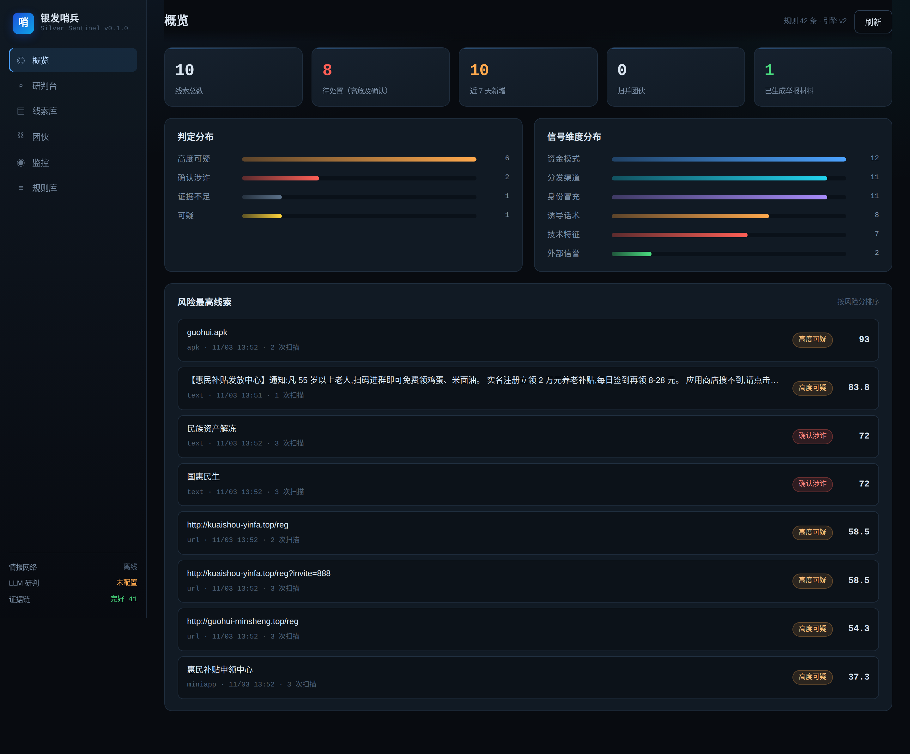
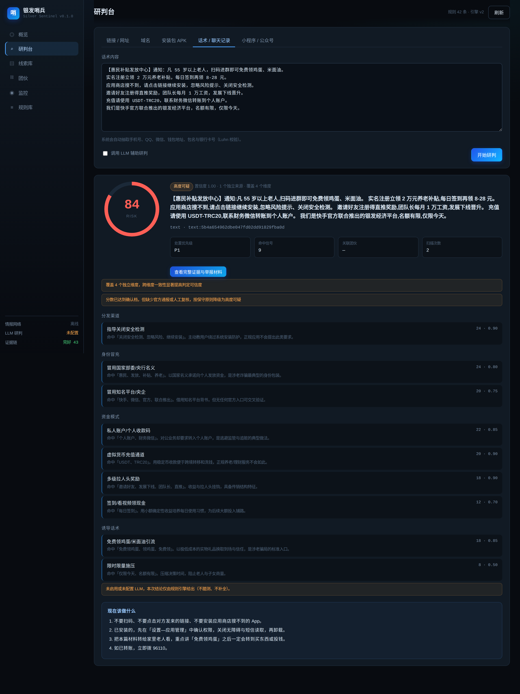
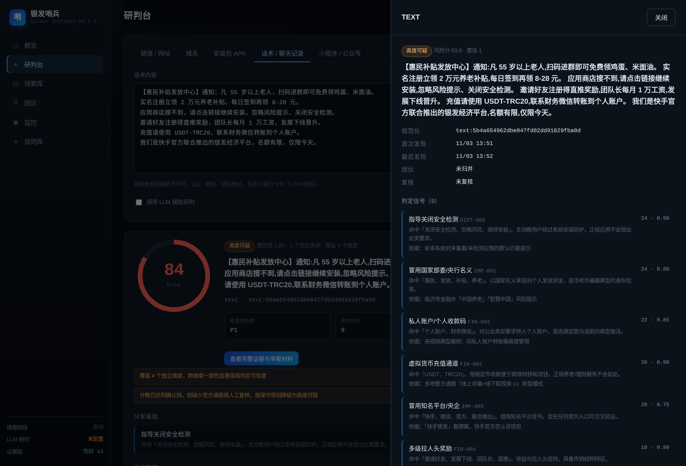

# 银发哨兵 · Silver Sentinel

面向「领鸡蛋骗局」线上化形态的 **识别 — 记录 — 监控 — 分析 — 处置** 闭环系统。

不是又一个钓鱼网址库，而是针对中国涉老诈骗特有载体的一套研判工程：**应用商店搜不到、没有 ICP 备案、只能扫码安装的仿冒「国家项目」App**，以及围绕它运转的微信群裂变、签到返利、拉人头与虚拟货币收款。



---

## 为什么需要它

线下那套「免费领鸡蛋 → 健康讲座 → 专家义诊 → 高价特效药」并没有消失，只是把最后一步搬到了手机上。央视 2026 年 10 月公布的典型案例里，一个团伙用「免费领鸡蛋」「专家义诊」引流，发展成「老板操控、讲师授课、门店收割」的产业链，抓获 120 人、涉案 500 余万元。同期公安部通报的涉诈 App 案件，涉案金额已达 60 亿元量级。

这类骗局有几个传统 URL 黑名单拦不住的特征：

| 特征 | 为什么难拦 |
| --- | --- |
| 载体是 APK，不是网页 | 网页能下线，安装包留在老人手机里继续跑 |
| 应用商店搜不到，只能扫码/外链装 | 绕过了商店审核这一道最有效的关口 |
| 域名寿命以周计 | 黑名单永远慢一步，需要靠模板/证书/收款地址做归并 |
| 话术高度本地化 | 「民族资产解冻」「国补」「高龄补贴」这类词，通用引擎识别不了 |
| 受害人不报案 | 老人常因「家丑不可外扬」错过追赃时机，线索需要主动发现 |

银发哨兵针对的正是这五点。

---

## 能力

| 环节 | 具体做什么 |
| --- | --- |
| **识别** | 输入链接 / 域名 / APK / 小程序名 / 聊天话术，输出风险分、判定等级、逐条可核对的依据 |
| **记录** | 线索库 + 证据哈希链，每条证据可追溯到采集时刻与原文摘录，篡改即断链 |
| **监控** | 关键词盯 CT 日志、品牌词探测仿冒变体、定点盯域名，按计划自动扫描并归并 |
| **分析** | 42 条可解释规则 + 可选 LLM 研判；跨资产按签名证书 / 模板指纹 / 钱包地址 / 包名前缀聚类成团伙 |
| **处置** | 一键生成 12321 / 12377 / 网络违法犯罪举报网站 / 12315 的结构化举报材料，附法条与证据清单 |



---

## 快速开始

```bash
git clone https://github.com/stellarissss/silver-sentinel.git
cd silver-sentinel
python3 -m pip install -e .

# 启动控制台（默认 http://127.0.0.1:8000）
silver-sentinel serve
```

零配置即可运行：不配任何 key 时，系统只用本地规则引擎，LLM 环节自动弃权，不会编造结论。

命令行同样可用，适合现场排查：

```bash
# 研判一条可疑链接（附带对方发来的话术）
silver-sentinel scan url "http://kuaishou-yinfa.top/reg?invite=888" \
  --text "免费领鸡蛋，应用商店搜不到，请点击继续安装"

# 分析一个安装包
silver-sentinel apk ./samples/guohui.apk

# 列出高危线索
silver-sentinel list --verdict high_risk

# 生成举报材料
silver-sentinel report 3 --channel 12321 --out 举报材料.md

# 校验证据链是否被改过
silver-sentinel verify-chain

# 加一个监控关键词
silver-sentinel watch add 领鸡蛋 --kind keyword --interval 180
```

### 可选配置

复制 `.env.example` 为 `.env`：

```bash
SILVER_ALLOW_NETWORK=1          # 关掉即为纯离线模式
SILVER_LLM_BASE_URL=https://api.deepseek.com/v1
SILVER_LLM_API_KEY=sk-...
SILVER_LLM_MODEL=deepseek-chat
URLHAUS_AUTH_KEY=...            # abuse.ch 免费申请
SILVER_ICP_API=https://your-icp-api/?domain={domain}
```

没有 LLM key 完全不影响使用 —— 规则引擎是主判据，LLM 只负责把证据串成叙事。

---

## 判定模型

三个刻意的设计决定，决定了这个工具能不能被信任：

**1. 用 noisy-OR 聚合，不用加权求和。**
求和会让「十条弱特征」轻易超过「一条铁证」。noisy-OR 下每条信号的边际贡献递减，符合证据的实际证明力：

```
risk = 1 − Π(1 − weightᵢ/100 × confidenceᵢ)
```

**2. 风险分与置信度分离。**
分数回答「有多像」，置信度回答「证据够不够、来自几个独立维度」。只命中一条信号时，即使权重很高也判「证据不足」 —— 系统允许弃权。

**3. 「确认涉诈」不由分数授予。**
机器最高只判到「高度可疑」。`confirmed` 只来自人工复核或命中官方通报清单。误伤一个正常应用的代价，远高于漏报一次。

每条信号都会回填它实际读到的原文，所以用户看到的不是「系统认为可疑」，而是：

> 命中「忽略风险、继续安装」。主动教用户绕过系统安装防护，正规应用不会提出此类要求。



规则库是声明式 YAML，加规则不用改代码：

```yaml
- id: PER-001
  category: persuasion
  title: 免费领鸡蛋/米面油引流
  weight: 18
  confidence: 0.85
  when:
    text_any: [免费领鸡蛋, 领鸡蛋, 送鸡蛋, 听课领礼品, 答谢会]
  detail: 以极低成本的实物礼品换取到场与信任，是涉老骗局的标准入口。
  cite: 央视网 2026-10-31「免费领鸡蛋」牵出「特效药」营销内幕
```

外挂覆盖自己的规则：`SILVER_RULES_PATH=./my_rules.yaml`。

---

## 架构

```
输入 → 规范化 → 被动情报采集 → 规则评分 → LLM 研判(可选) → 落库 → 证据链 → 团伙归并
                     │
                     ├── crt.sh 证书透明度（兄弟域名、关键词发现）
                     ├── RDAP（域名年龄）
                     ├── URLhaus / OpenPhish（恶意地址）
                     ├── DNS 变体探测（仿冒品牌）
                     └── APK 静态解析（AXML / 权限 / 证书 / 模板指纹 / 钱包地址）
```

```
src/silver_sentinel/
├── normalize.py        实体规范化与指标抽取（URL 去参、包名/钱包/手机号）
├── scoring/engine.py   声明式规则求值 + noisy-OR 聚合 + 弃权逻辑
├── rules/builtin.yaml  42 条判定规则（分发/冒充/资金/话术/技术/信誉）
├── collectors/         被动情报采集（不访问可疑站点）
│   └── apk.py          自实现二进制 AXML 解析，无 androguard 依赖
├── analyzers/          LLM 研判（严格 JSON + 弃权）与团伙聚类（Union-Find）
├── intake.py           扫描编排
├── respond.py          举报材料与「给家属的一页纸」
├── monitor.py          基于 next_run_at 的轻量调度
└── api.py + web/       FastAPI + 原生前端（无构建步骤）
```

存储默认单文件 SQLite（WAL），改 `SILVER_DB_URL` 可切 Postgres。

---

## 数据来源与合规边界

**只读第三方情报，不碰可疑站点本身。** crt.sh、RDAP、URLhaus、OpenPhish 都是公开的被动数据源。理由有两条：访问即给对方贡献 UV，还可能触发其反制（记录分析者 IP、下发定向载荷）；而静态证据已足够支撑判定，动态取证应由执法或平台侧在受控环境完成。

**不提供可直接点击的诈骗网址。** 这个仓库里没有「XX 骗局网站清单」——那种清单既会过期，也会被二次传播利用。系统提供的是判定方法、可核查的证据结构和举报通路。

**证据链可自证。** 每条证据的 `chain_hash = H(上一条 chain_hash | 本条 sha256 | 采集时间)`，删改一条即断链，适合作为向监管提交材料时的完整性证明。

---

## 已知局限

- **ICP 备案**没有稳定公开 API。默认按「未知」处理，不参与加分；配置 `SILVER_ICP_API` 后才启用该判定。这是刻意的：宁可少判，不可错判。
- **微信生态**（小程序、公众号、群聊）无法自动化采集，只能录入名称后做文本与名单匹配。这部分需要人工配合截图。
- **LLM 不是必需项**。没有 key 时系统照常工作，只是少了「把信号串成剧本」的那层叙事。
- **不替代执法**。系统输出是线索，不是定性结论；同名不同主体的情况真实存在，命中通报后必须人工核对包名、域名与收款方。

---

## 文档

- [威胁画像：领鸡蛋骗局如何线上化](docs/01-威胁画像.md)
- [判定规则与评分模型](docs/02-识别规则.md)
- [处置手册：举报渠道、材料模板与家属话术](docs/03-处置与举报.md)
- [架构、部署与长期运维](docs/04-架构与运维.md)
- [调研来源](docs/05-调研来源.md)

---

## 免责声明

本项目用于反诈研究、预警与举报辅助，不构成法律意见。所有判定均为基于公开特征的技术推断，最终认定以有权机关调查结果为准。使用者应遵守《个人信息保护法》《网络安全法》等法律法规，不得将本工具用于侵犯他人合法权益的用途。

MIT License.
