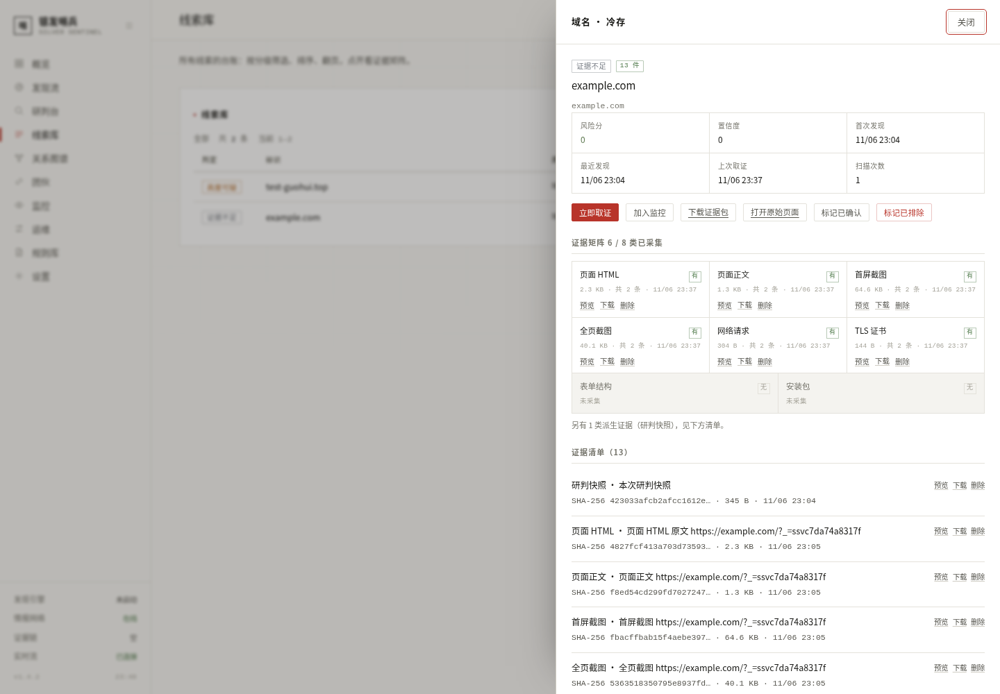
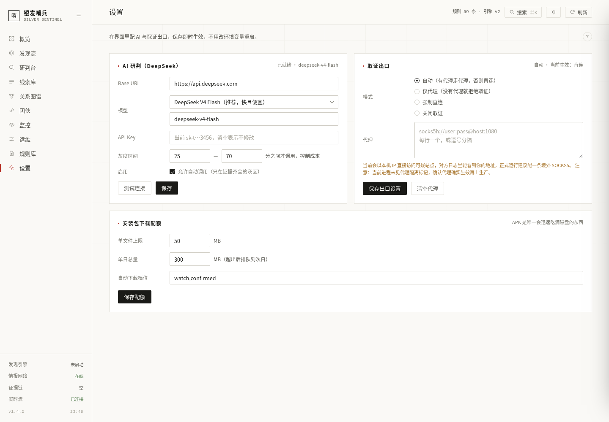

# 取证闭环与运行时配置（v1.5）

> 落地时间：2026-11-06
> 对应方案：[15-发现监控评估-重构方案](15-发现监控评估-重构方案.md) 的 P0–P3
> 一句话：把「发现 → 取证 → 评估 → 分级 → 监控 → 变更 → 再评估」从一堆函数接成一条真的会自己跑的链，并把每一步为什么没跑通写在界面上。

---

## 一、为什么要做这件事

v1.4 的问题不是「没有能力」，而是**能力之间没人接线**：

| 症状 | 真实原因 |
| --- | --- |
| 线索页 2,993 条、能处置的 843 条 | `/api/stats` 把已排除的误报也算进总数，所有比率分母都错 |
| 页面证据 0 条，91% 是「证据不足」 | `probe_web` 写好了，但只有手工调用；调度里没人喊它 |
| 风险分最高 38.8 | 因为系统几乎没看过页面内容，只能靠域名特征打分 |
| 团伙永远 0 | 社区发现要求「团内 ≥2 个可疑」，但可疑判定依赖证据 |
| 监控永远空页 | `WatchTarget` 只能手加，分级产出结果没有回流 |

所以 v1.5 的主线不是「加功能」，是**把已有的四块（发现、取证、评估、监控）接起来，并让接口口径自洽**。

---

## 二、取证队列：让「取证」自己发生

### 2.1 表结构

```python
class CaptureTask(Base):
    __tablename__ = "capture_tasks"
    asset_id, state, priority, attempts, reason, next_run_at, error, stats, created_at, finished_at
```

- `state`：`queued / running / done / failed / skipped`
- `priority`：数字越小越先跑

### 2.2 优先级：档位基准 − 分数/5

```python
PRIORITY = {confirmed: 10, watch: 25, candidate: 60, cold: 200}

def priority_of(asset):
    return max(1, PRIORITY.get(asset.tier, 80) - min(20, asset.score / 5))
```

同档内分数高的先取证——高危目标早一分钟看到页面都有意义。冷存档排在最后，只在队列空闲时才轮到。

### 2.3 三条入口，同一个函数

| 入口 | 触发方式 |
| --- | --- |
| 调度 | `run_cycle` 里先 `backfill` 再 `run_batch(2)` |
| 界面 | `POST /api/assets/{id}/capture`（立即取证）、`POST /api/capture/run`（取一批） |
| 监控复访 | `monitor.run_target` 对资产级目标直接调 `capture_asset` |

三个入口都收敛到 `capture_asset(asset_id)`，所以**状态写入只有一处**（`_set_capture_state`），不会出现「调度跑过、但界面显示未取证」。

### 2.3.1 为什么取证必须挤在同一个线程里

这是实测踩出来的，不是设计洁癖：

- **写锁**：SQLite 只有一个写事务。调度器如果先写一条 `ScanRun` 再把事务揣在手里去调取证，取证自己要写证据表 → `database is locked`。WAL 只解决读写并发，不解决写写。
  修法是把一次执行拆成「短事务读快照 → 无事务执行 → 短事务回写」，见 `monitor.run_target`。
- **线程亲和**：Playwright 的同步对象和创建它的线程绑定。并发来的三个请求各占一个 FastAPI 线程池线程，第二个复用同一个 browser 会直接抛
  `Cannot switch to a different thread`。**加锁解决不了**——锁只是让它们排队，换的还是不同的线程身份。
  所以取证固定丢进 `ThreadPoolExecutor(max_workers=1)`：既串行（一台 2G 机器同时开两个 Chromium 就是 OOM），又保证永远是同一个线程。

实测（`POST /api/assets/2/capture` 三连发）：4.9s / 9.1s / 14.3s 依次返回，全 `ok=true`，日志无 `locked`、无 `greenlet` 报错。
改之前同样的三连发是 1 成功 + 2 个 `Cannot switch to a different thread`。

同样地，`monitor.run_due` 加了非阻塞重入锁：后台 tick 和界面上的「立即检查」撞在一起时，后到的直接返回空，不会把同一个目标抓两遍。

### 2.4 失败退避

| 尝试 | 下次时间 |
| --- | --- |
| 1 | +10 分钟 |
| 2 | +40 分钟 |
| 3 | 标记 `failed`，不再自动重试 |

失败原因写进 `asset.capture_error`，界面上鼠标悬停「取证」列就能看到，运维页另有「最近失败」列表。

---

## 三、证据：八格矩阵 + 派生证据

### 3.1 固定八格

`page_html / page_text / screenshot / screenshot_full / network / tls_cert / forms / apk`

每一格在界面上回答三个问题：**有没有、多大、什么时候**。缺的格子直接把 `capture_error` 写出来，而不是留一片空白让人猜。

其余类型（`assessment` 研判快照、`qrcode` 二维码、`dns` 解析、`capture_error` 失败留痕）归入「派生证据」，在矩阵下方一行说明，不占格子——塞进格子会让最后一行只剩一格、拉成通栏，看起来像排版坏了。



### 3.2 预览不塞进格子

第一版把预览放在 168px 的格子里，一段 HTML 会把那格拉成两屏高，整行跟着变形。现在预览是矩阵下方的通栏：图片按宽度自适应，长文本自己滚，超过 60KB 截断并提示下载。

### 3.3 删除是软删除

```
DELETE /api/evidence/{id}?reason=...
→ deleted_at / deleted_by / delete_reason 三个字段留底，文件移进 data/trash/
→ verify_chain 仍然通过（链上只多一条 tombstone，不改历史哈希）
→ 7 天后 purge_trash 物理清理（只删文件，记录不动）
```

实测：删除第 3 条证据后 `verify_chain` 仍是 `ok=True, checked=19`，恢复后 head 不变。

### 3.4 整套导出

`GET /api/assets/{id}/evidence.zip` → `manifest.json`（资产信息 + 每条证据的 sha256 / chain_hash / 采集时间）+ `evidence/` 目录。

v1.5 改成「写临时文件 + FileResponse + 后台删除」：含安装包的资产能到几十 MB，原来 `BytesIO` 会把整包读进内存，两个人同时点下载就是几百 MB 峰值。

---

## 四、变更检测：复访时要能说出「哪里变了」

每次取证写一条 `AssetSnapshot`，只保留最近 6 条：

| 指纹 | 算法 | 判定阈值 |
| --- | --- | --- |
| 正文 | 64 位 simhash（中文二元 + 英文单词，词频加权） | 汉明距离 > 14 → 「页面内容改版」 |
| 截图 | dHash（9×8 灰度差分） | 汉明距离 > 12 → 「页面视觉变化」 |
| 证书 | subject/issuer/validFrom 的 sha256 | 变化 → 「证书更换」 |
| 解析 | A 记录集合 | 集合不等 → 「解析地址变化」 |
| 安装包 | sha256 | 变化 → 「安装包更换」 |
| 状态 | HTTP status | 4xx/5xx 翻转 → 「页面下线 / 页面恢复」 |

变更项写进 `asset.meta["changes"]`（最多 20 条）并同步 `DiscoveryEvent(source="change")`，抽屉里能看到「什么时候、变了什么」。

---

## 五、风险指数：一个能解释的数字

```python
WEIGHTS = {high_ratio: 0.40, new_high: 0.30, evidence: 0.20, watch: 0.10}
```

| 项 | 含义 | 满分条件 |
| --- | --- | --- |
| 高危占比 40% | 有效资产里高危及以上的比例 | 50% 高危即满分 |
| 高危新增 30% | 近 24 小时新增高危 / 有效资产 | 5% 即满分（再高就是全面失控） |
| 证据完备 20% | 有页面 HTML 或截图的资产比例 | 100% |
| 监控覆盖 10% | 已纳管监控 / （已确认 + 观察中） | 100% |

为什么不用平均分：2,000 条冷存资产会把一个刚出现的高危团伙稀释成 12 分，看起来「风险很低」——而这正是最危险的误读。

界面上一项一行：分数 + 进度条 + 原始计数（`3/812`、`7/24h`、`456/812`、`402/413`）+ 权重。四项都能点开看 `hint` 说明它到底在算什么。

**小样本保护**：有效资产 < 5 时额外显示「样本不足 5 条，指数仅供参考」——否则 1 条高危就是 100 分，看着像天塌了。

**趋势**从 `data/replica/db/sentinel-YYYYMMDD.db` 快照重建，没有快照就老实显示「暂无历史」，不编一条平滑曲线。

---

## 六、运行时配置：密钥在前端改，且不用重启

### 6.1 优先级

```
数据库 app_settings  >  环境变量 / .env  >  内置默认值
```

5 秒 TTL 缓存；写入即 `invalidate()`，下一次读取就是新值。

### 6.2 密钥只回显掩码

```
GET /api/settings  →  api_key_masked: "sk-t…3456", has_key: true
POST /api/settings/llm  ←  api_key 留空 = 不修改
```

留空表示不修改，是为了避免前端把掩码当新密钥写回去（这是很常见的自伤）。原文永远不出服务端，也不进日志。

### 6.3 「配置过」和「取到默认值」是两件事

`egress.mode` 默认 `auto`。如果代码只看「当前值」，就会把默认值当成用户的选择，从而覆盖掉 `Guard(allow_direct=False)` 的 fail-closed 设定——这是 v1.5 开发中真实踩到的坑，测试直接抓到了：

```python
def is_set(key) -> bool:
    """这个键是否被显式写过（区别于「取到了默认值」）。"""
```

`Guard.sync_runtime()` 只在 `configured=True` 时才覆盖实例配置，否则尊重构造时的 fail-closed。

### 6.4 出口四态

| 模式 | 行为 |
| --- | --- |
| `auto` | 有代理走代理，没有就本机直连（默认；保证第一次部署就能取证） |
| `proxy` | 必须代理，否则拒绝取证（严格隔离） |
| `direct` | 强制直连 |
| `off` | 关闭取证 |

保存后下一次出站即生效，不需要重启——`Guard.sync_runtime()` 每次出站前比对配置指纹，变了就重建代理池。

⚠️ **直连的代价**：目标站点日志里会留下采集机 IP。正式运行建议配一条境外 SOCKS5，`socks5h://` 让代理解析 DNS。



### 6.5 APK 配额

| 项 | 默认 | 说明 |
| --- | --- | --- |
| 单文件上限 | 50 MB | 超过直接放弃，不截断 |
| 单日总量 | 300 MB | 超出后排队到次日 |
| 自动下载档位 | `watch,confirmed` | 候选档固定 10 MB 上限，其余档不自动下 |

配额检查与下载串行化（`threading.Lock`）：配额是「先查已用、再下载」，两个线程同时进来会各自看到旧值、一起把当天量顶穿。下载走 `append_file`（流式 sha256 + 复制），不把几十 MB 整块读进内存。

---

## 七、词库：不抄新闻标题，按场景推理

### 7.1 规模与结构

362 → **915 词条**（去重后 843），17 个语义簇。新增 11 簇：

| 簇 | 词条数 | 推理路径 |
| --- | --- | --- |
| `health_product` | 99 | 老人最常被推销的品类：理疗仪、蜂胶、氨糖、干细胞、肽 |
| `elder_care` | 48 | 养老政策与服务机构名：居家养老、日间照料、以房养老 |
| `project_scam` | 54 | 工程/民族资产类：西部大开发、一带一路、军民融合 |
| `channel` | 54 | 传播路径：微信群、扫码进群、熟人拉人、直播间 |
| `investment` | 48 | 资金模式：日息、保本、原始股、外汇、数字资产 |
| `honorific` | 34 | 称谓敬语：老师、主任、部长、首长（冒充身份的必要件） |
| `payment` | 32 | 收款方式：对公转账、扫码付、USDT、跑分 |
| `variant` | 22 | 已知词的变体：国惠→国恵/国汇、惠民→惠明/慧民 |
| `collectible` | 21 | 收藏品：纪念币、字画、邮票、玉石 |
| `ai_hype` | 16 | 新瓶装旧酒：AI 养老、智能机器人分红、算力租赁 |
| `travel_elder` | 10 | 低价游：免费旅游、康养考察、旅居养老 |

生成方法是「人群 → 场景 → 政策 → 渠道 → 资金」五问，而不是抓新闻标题。新闻里的词（`领鸡蛋`、`民族资产解冻`）团伙自己会规避，靠它们只能抓到反应最慢的那批。

### 7.2 弱词降权

`WEAK_ONLY` 扩到 330 词，权重 ×0.55。像「健康」「养老」这种词命中率高但区分度低，单独命中不足以入池，必须与强词共现。

### 7.3 误报词自动搁置

```python
def _suppressed_terms():
    # 命中 ≥ 25 次且 dismissed 占比 ≥ 0.8 的词，不再进 DNS 探测
```

1 小时缓存。人工在「线索库」里点「标记已排除」时，会把该资产命中的词回写到 `KeywordHit.dismissed`——这是唯一可靠的「这条词是误报」信号。没有这个回写，词库永远不知道自己哪条规则在制造噪声。

### 7.4 组合域名探测

只用于 DNS 探测（存在性判断），不用于匹配：

- 地区 × 主题：`hebei-huimin`、`henan-yanglao`
- 主题 × 后缀：`guohui-minsheng`、`yanglao-zhongxin`
- 数字变体：`guohui2026`、`guohui88`、`guohuivip`

---

## 八、实测数据（本地实例，2026-11-06）

| 项 | 结果 |
| --- | --- |
| `POST /api/assets/2/capture`（example.com） | `ok=true`，5.32 秒 |
| 一次取证落盘 | 6 类：page_html 2.3KB / page_text 1.3KB / screenshot 66KB / screenshot_full 40KB / network / tls_cert |
| 证据矩阵 | 6/8（forms、apk 为空属正常——示例页没有表单也没有安装包） |
| 单条预览 | `200`，image/png 66,171B |
| 整套 ZIP | `200`，318,764B，20 个条目，manifest 带哈希链 |
| 软删除 → 恢复 | `verify_chain` 全程 `ok=True, checked=19`，head 不变 |
| 出口四态 | 切到 `proxy` 且无代理 → 取证返回「出站被拒：出口模式为「仅代理」」；切回 `auto` → 恢复直连取证 |
| 前端回归 | 20 项交互断言全通过，无 console 报错 |

---

## 八点五、上线实录：三次「本地全绿、线上一趟空」的坑

v1.5 部署到 `119.45.14.187` 时连踩三个只有生产环境才会暴露的问题。记在这里，
因为它们的共同点是——报错信息和真实原因完全不是一回事。

### 坑一：缺依赖（`/api/capture/queue` 直接 500）

`capture.py` 顶层 `from PIL import Image`，但 Pillow 从来没进过 `dependencies`。
开发机预装了，166 项测试全绿；线上 `pip install` 之后一 import 就炸。

修法：`pillow>=10` 进核心依赖；PIL 改成容错导入（真缺了只少个截图指纹，不让整个模块死）；
`install.sh` 增加**导入自检**，装完先 import 8 个核心模块，失败当场报错而不是等用户点开页面。

### 坑二：取证一条都没成功过（`出站被拒：出口模式为「仅代理」`）

线上 `SILVER_OPSEC_ALLOW_DIRECT=0`（fail-closed），但从来没配过 SOCKS5。
于是每一次取证都在出站检查这一步被挡回去，657 条线索全是「待取证」。
这不是 bug，是配置与默认值打架：安全默认把功能关死了，而界面上没人告诉你「因为没配代理」。

处置：按既定决策切到 `auto`（有代理走代理，没有就本机直连），取证立刻通了。
界面在「设置 → 出站」里会明示当前是直连、以及它的代价（暴露采集机 IP）。

### 坑三：浏览器装了，但服务找不到

`playwright install chromium` 默认装进**执行安装那个用户**的 `~/.cache/ms-playwright`，
也就是 `/root/.cache/`；服务单元是 `User=silver` + `ProtectHome=true`。
 chromium 对服务来说不存在，`launch()` 必然失败。

更坏的是失败方式：`sync_playwright().start()` 会在当前线程留下一个**仍在运行**的 event loop，
下一次 `start()` 直接抛 `It looks like you are using Playwright Sync API inside the asyncio loop`。
真正的「找不到浏览器」被这句话完全盖住，看起来像是把同步 API 用错了。

修法三件套：
1. `install.sh` 把浏览器固定装到 `$APP_DIR/ms-playwright`，并写 `PLAYWRIGHT_BROWSERS_PATH` 进 env；
2. `_ensure_browser` 包 try/except，记录真实原因并清掉半成品状态；
3. `capture.py` 一旦发现「浏览器不可用」就换一个新线程，别让线程池带着毒继续跑。

修完实测：`xjzb-douyin.cc` 10.1 秒落下 5 类证据，`zczb-douyin.cc` 17.1 秒落下 6 类（含全页截图）。
队列从 0 变成 `queued=21 / running=1 / done=3 / failed=0`，`pending_assets=649` 开始消化。

---

## 九、已知边界

1. **取证只能看到登录墙之前的东西**。需要注册/邀请码的落地页，抓到的只是引导页——这本身也是证据（记录「它要你先下载 App」），但看不到内页。
2. **simhash 对整站换模板会误报改版**。阈值 14 是折中值；同一团伙换主题色会被判成「改版」，看证据时以截图为准。
3. **APK 动态分析仍需 MobSF/真机**。未配置时只有静态推演，界面会如实标注 `static-only`。
4. **风险指数的四项权重是经验值**，不是统计拟合结果。它的用途是「今天要不要多看两眼」，不是给单个资产定性。
5. **直连会暴露采集机 IP**。这是 `auto` 模式的固有代价，正式运行请配代理。
6. **软删除不是物理删除**。文件留在 `data/trash/`，删除记录（tombstone）永久保留。要腾磁盘得手动 `silver-sentinel trash --purge-days 30`——刻意不做成自动的，因为「什么时候丢掉证据」该由人决定。
